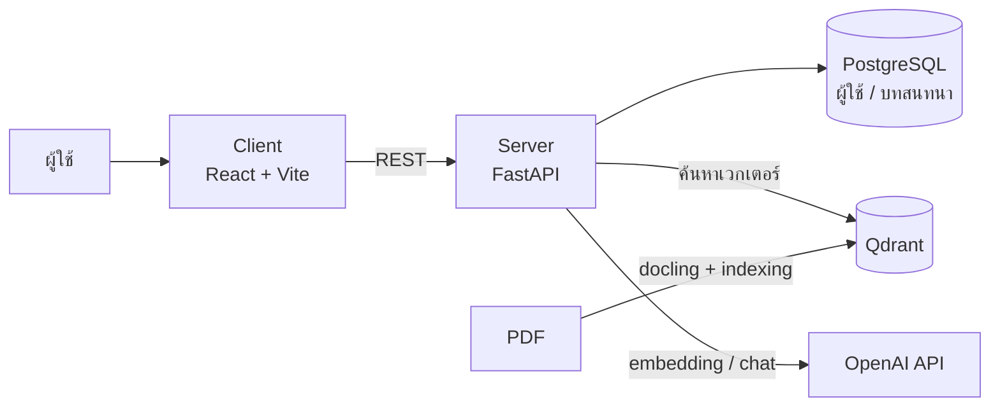

# LannaFinChat

แชตบอตภาษาไทยที่ตอบคำถามจากเอกสาร PDF ด้วยเทคนิค RAG (Retrieval-Augmented Generation)


โครงงานสำเร็จการศึกษา สาขาวิทยาการคอมพิวเตอร์ มหาวิทยาลัยเทคโนโลยีราชมงคลล้านนา (RMUTL)

## สารบัญ

- [ภาพรวม](#ภาพรวม)
- [คุณสมบัติ](#คุณสมบัติ)
- [สถาปัตยกรรม](#สถาปัตยกรรม)
- [เริ่มต้นใช้งาน](#เริ่มต้นใช้งาน)
- [การตั้งค่า Environment](#การตั้งค่า-environment)
- [คำสั่งที่ใช้บ่อย](#คำสั่งที่ใช้บ่อย)
- [API](#api)
- [Deployment](#deployment)
- [เอกสารเพิ่มเติม](#เอกสารเพิ่มเติม)
- [ผู้พัฒนา](#ผู้พัฒนา)

## ภาพรวม

ผู้ใช้ถามคำถามเป็นภาษาไทย ระบบค้นหาเนื้อหาที่เกี่ยวข้องจากเอกสาร PDF ที่ index ไว้ใน Qdrant แล้วให้ LLM สรุปคำตอบพร้อมอ้างอิงเอกสาร

โปรเจกต์เป็น monorepo แยกสองส่วน:

| ส่วน | เทคโนโลยี |
|------|-----------|
| `server/` | FastAPI, SQLAlchemy, Alembic, LangChain / LangGraph, OpenAI, Qdrant, PostgreSQL (จัดการด้วย `uv`) |
| `client/` | React 18, TypeScript, Vite, Tailwind CSS, MUI (จัดการด้วย `npm`) |

## คุณสมบัติ

- **แชต 3 โหมด:** ผู้ใช้ที่ล็อกอิน, anonymous และ guest (guest เก็บประวัติลง PostgreSQL แยกตาม `machine_id`)
- **RAG ภาษาไทย:** ค้นหาจาก Qdrant พร้อมปรับ query ให้เหมาะกับภาษาไทย และแสดงเอกสารอ้างอิงในคำตอบ
- **จัดการเอกสาร:** อัปโหลด ลบ และ index PDF (แปลงด้วย docling) ผ่านหน้าแอดมิน
- **ยืนยันตัวตน:** JWT (access + refresh token) พร้อม rate limit ต่อ IP
- **แอดมิน:** สถิติการใช้งาน จัดการและ export บทสนทนา จัดการผู้ใช้
- **ประเมินผล:** ผู้ใช้ให้ feedback รายข้อความและทำแบบสำรวจความพึงพอใจ

## สถาปัตยกรรม



```
cs_project/
├── client/                 # React + TypeScript
│   └── src/{components,services,contexts,hooks,utils}
├── server/
│   ├── app/
│   │   ├── chat/           # router ของโหมด auth / anonymous / guest และ feedback
│   │   ├── routers/        # login, admin, จัดการ PDF
│   │   ├── rag_system/     # ตัว RAG (chatbot)
│   │   ├── docs_process/   # แปลง PDF
│   │   └── login_system/   # JWT
│   ├── alembic/            # database migrations
│   ├── scripts/            # indexing_docs.py
│   └── pdfs/               # PDF ที่จะ index
├── docs/                   # เอกสารออกแบบและวิเคราะห์ระบบ
├── docker-compose.yaml     # dev stack
├── docker-compose.prod.yaml
└── justfile                # คำสั่งหลักของ monorepo
```

## เริ่มต้นใช้งาน

### สิ่งที่ต้องมี

- [uv](https://docs.astral.sh/uv/) และ Python 3.13+
- Node.js 18+ และ npm
- [just](https://github.com/casey/just)
- Docker และ Docker Compose
- OpenAI API Key

### ติดตั้งและรัน

```bash
git clone https://github.com/JeerasakAnanta/cs_project
cd cs_project

# 1) ตั้งค่า environment (ดูหัวข้อถัดไป)
cp server/.env.example server/.env
cp client/.env.example client/.env

# 2) เปิด PostgreSQL และ Qdrant
docker compose up -d db qdrant

# 3) ติดตั้ง dependency และสร้างตารางด้วย migration
just deps
just migrate

# 4) วาง PDF ไว้ใน server/pdfs/ แล้ว index ลง Qdrant
just index-docs

# 5) รัน server และ client พร้อมกัน
just dev
```

| บริการ | URL |
|--------|-----|
| Client | http://localhost:5173 |
| Server | http://localhost:8001 |
| Swagger UI | http://localhost:8001/docs |
| Qdrant dashboard | http://localhost:6333/dashboard |

หรือรันทุกอย่างผ่าน Docker (dev stack มี hot-reload ของ server และ client): `docker compose up -d`

## การตั้งค่า Environment

ไฟล์ `server/.env` (ดูค่าทั้งหมดใน `server/.env.example`):

| ตัวแปร | คำอธิบาย |
|--------|----------|
| `DB_USER`, `DB_PASSWORD`, `DB_HOST`, `DB_NAME` | การเชื่อมต่อ PostgreSQL |
| `OPENAI_API_KEY`, `OPENAI_MODEL`, `EMBEDDINGS_MODEL` | OpenAI (ค่าตัวอย่าง `gpt-4o-mini`, `text-embedding-3-large`) |
| `QDRANT_VECTERDB_HOST`, `COLLECTION_NAME` | Qdrant (สะกด `VECTERDB` ตามโค้ดจริง) |
| `SECRET_KEY`, `REFRESH_SECRET`, `ALGORITHM`, `ACCESS_TOKEN_EXPIRE_MINUTES` | JWT |
| `DEBUG` | `true` จะเปิด CORS สำหรับ localhost |

ไฟล์ `client/.env`: `VITE_API_BASE_URL` (ค่าเริ่มต้น `http://localhost:8001`)

> เมื่อรันด้วย Docker Compose ให้ตั้ง `DB_HOST=db:5432` และ `QDRANT_VECTERDB_HOST=http://qdrant:6333`
> อย่า commit ไฟล์ `.env` และเปลี่ยนค่า `CHANGE_THIS_*` ทั้งหมดก่อนใช้งานจริง

## คำสั่งที่ใช้บ่อย

รันที่โฟลเดอร์ราก ดูทั้งหมดด้วย `just`

| คำสั่ง | ทำอะไร |
|--------|--------|
| `just deps` | ติดตั้ง dependency ทั้ง server และ client |
| `just update` | อัปเดต dependency ทั้งสองฝั่ง |
| `just dev` | รัน server และ client พร้อมกัน |
| `just migrate` | รัน Alembic migration |
| `just new-migration "msg"` | สร้าง migration จาก model |
| `just index-docs` | index PDF ใน `server/pdfs/` ลง Qdrant |
| `just check` | format, lint และ build ฝั่ง client |
| `just build` | build Docker image |

โปรเจกต์ยังไม่มี test suite ให้ใช้ `just check` ตรวจฝั่ง client อย่างน้อยทุกครั้งที่เปลี่ยนโค้ด

## API

Swagger UI ที่ `/docs` ของ server ด้านล่างเป็นกลุ่มหลัก:

| กลุ่ม | Prefix | หมายเหตุ |
|-------|--------|----------|
| Authentication | `/api` | `register`, `login`, `logout`, `refresh` |
| Chat (ล็อกอิน) | `/chat` | `conversations` และ messages ของผู้ใช้ |
| Chat (anonymous) | `/chat/anonymous` | `message`, `conversations` |
| Chat (guest) | `/chat/guest` | `message`, `conversations`, `stats`, `machine-id` |
| Feedback | `/chat` | feedback ต่อข้อความ |
| PDF | `/api/pdfs` | `upload`, `index`, `reindex`, `stats`, ลบไฟล์ (แอดมิน) |
| Admin | `/admin`, `/admin/conversations` | สถิติและจัดการบทสนทนา (ต้องเป็นแอดมิน) |

## Deployment

GitHub Actions (`.github/workflows/`) build Docker image ของ server และ client แล้ว push ไปที่ `ghcr.io/jeerasakananta/cs_project-{backend,frontend}` บน self-hosted runner

รัน production stack จาก image ที่ build แล้ว:

```bash
docker compose -f docker-compose.prod.yaml up -d
```

Frontend เปิดที่พอร์ต 8002 (nginx) รายละเอียดเพิ่มเติมอยู่ที่ [docs/DEPLOYMENT.md](docs/DEPLOYMENT.md)

## เอกสารเพิ่มเติม

โฟลเดอร์ [`docs/`](docs/) มีเอกสารออกแบบระบบ เช่น

- [ER Diagram](docs/ER_DIAGRAM.md) และ [Data Dictionary](docs/DATA_DICTIONARY.md)
- [Sequence Diagrams](docs/SEQUENCE_DIAGRAMS_ANALYSIS.md) และ [Use Case](docs/SYSTEM_USE_CASE_ANALYSIS.md)
- [Guest Mode](docs/GUEST_MODE_FEATURE.md)
- [ขอบเขตโครงการ](docs/PROJECT_SCOPE_SUMMARY.md)

## ผู้พัฒนา

จีระศักดิ์ อนันต๊ะ ([jeerasakananta@gmail.com](mailto:jeerasakananta@gmail.com)) สาขาวิทยาการคอมพิวเตอร์ คณะวิทยาศาสตร์และเทคโนโลยีการเกษตร มหาวิทยาลัยเทคโนโลยีราชมงคลล้านนา

พบปัญหาหรือมีข้อเสนอแนะ เปิด [Issue](https://github.com/JeerasakAnanta/cs_project/issues) ได้เลย
